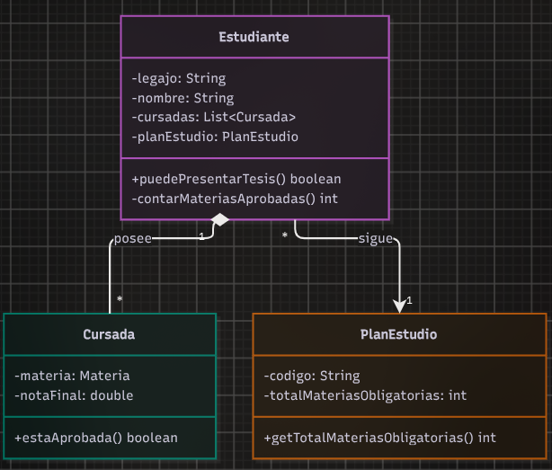
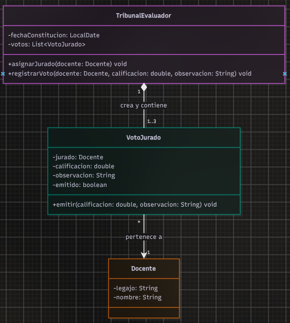
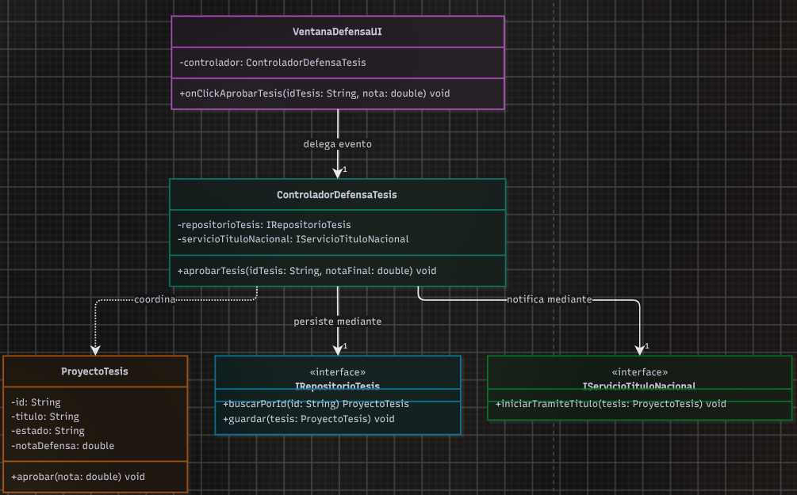
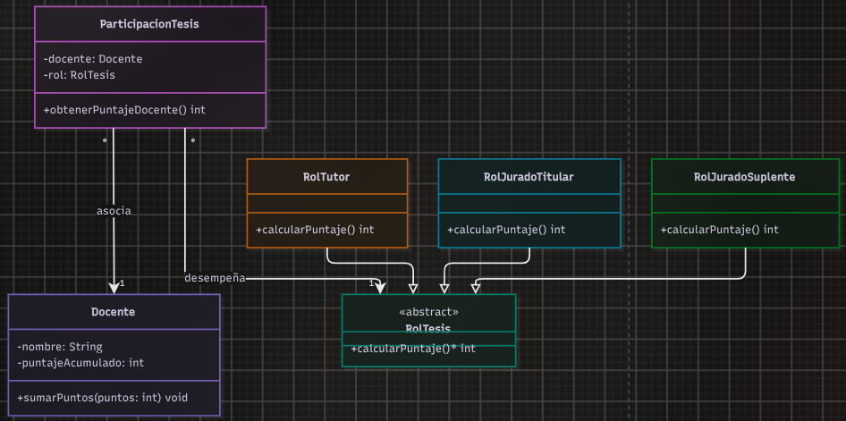
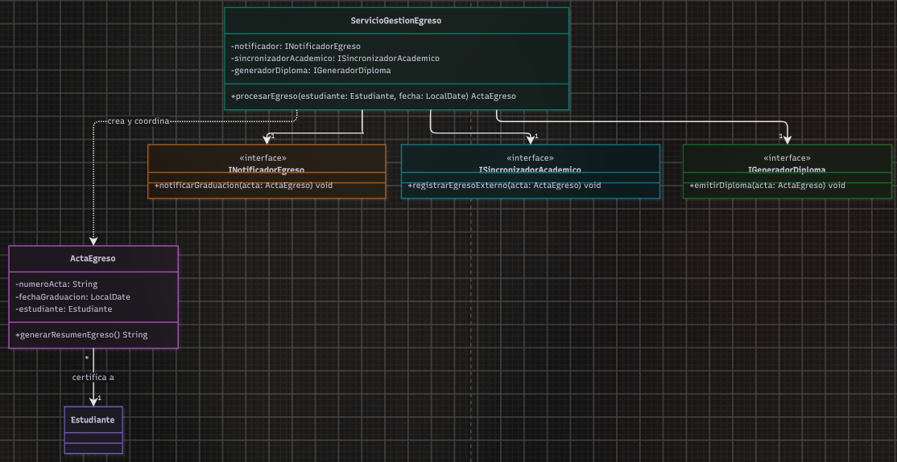

# Trabajo Práctico: Asignación de Responsabilidades (GRASP)
**Universidad Nacional de Misiones (UNaM) - FCEQYN**  
**Cátedra:** Programación Orientada a Objetos II  

---

## Ejercicio 1: Experto en Información (Information Expert)

### Problema identificado ("Antes")
El diseño actual viola el patrón **Experto en Información** y rompe el **encapsulamiento** al delegar la validación académica a una clase externa (`ValidadorAcademico`). Esta clase le solicita al `Estudiante` su lista de materias cursadas y las notas obtenidas para procesarlas por fuera, generando un acoplamiento innecesario y exponiendo el estado interno del alumno.

### Solución propuesta ("Después")
El verdadero dueño de la información sobre las materias cursadas y sus calificaciones es el propio **`Estudiante`**, apoyándose en sus objetos **`Cursada`** (que conocen su nota y determinan si están aprobadas) y en su **`PlanEstudio`** (que conoce la cantidad total de materias obligatorias requeridas).

* **Clase eliminada:** `ValidadorAcademico`.
* **Responsabilidades asignadas:**
  * `Cursada`: Incorpora el método `estaAprobada(): boolean` para evaluar si su calificación alcanza el mínimo aprobatorio.
  * `PlanEstudio`: Provee `getTotalMateriasObligatorias(): int`.
  * `Estudiante`: Incorpora el método `puedePresentarTesis(): boolean`, recorriendo internamente sus cursadas aprobadas y comparando el total contra su plan de estudios.

  

---

## Ejercicio 2: Creador (Creator)

### Problema identificado ("Antes")
La capa de interfaz de usuario (`PantallaAsignarJurado`) está instanciando directamente entidades del modelo de dominio (`new VotoJurado()`) y ensamblando colecciones internas para luego inyectarlas mediante `setVotos()`. Esto acopla fuertemente la vista con la estructura interna del negocio y viola la separación de capas.

### Solución propuesta ("Después")
Aplicando el patrón **Creador**, la responsabilidad de instanciar los objetos `VotoJurado` debe recaer en **`TribunalEvaluador`**, ya que:
1. Contiene y agrega estrechamente a los objetos `VotoJurado` (relación de composición `1` a `1..3`).
2. Posee y registra los datos necesarios para inicializarlos (los docentes designados como jurados).

* **Responsabilidades asignadas:**
  * `PantallaAsignarJurado`: Únicamente captura la selección del docente y envía el mensaje `asignarJurado(docente)` al tribunal.
  * `TribunalEvaluador`: Elimina el método `setVotos()` e incorpora `asignarJurado(docente: Docente)`, encargándose internamente de validar el cupo de 3 miembros y ejecutar `new VotoJurado(docente)`.

  

---

## Ejercicio 3: Controlador (Controller)

### Problema identificado ("Antes")
Acoplar `VentanaDefensaUI` directamente con la persistencia en base de datos y con la API externa del sistema nacional de títulos provoca una mezcla grave de responsabilidades entre la capa de presentación, la lógica de negocio y la infraestructura. Ante cualquier cambio en las reglas de aprobación o en el servicio externo, se debe modificar el código de la interfaz gráfica.

### Solución propuesta ("Después")
Se aplica el patrón **Controlador** (de caso de uso) introduciendo la clase **`ControladorDefensaTesis`** como intermediario entre la vista y el modelo de dominio/infraestructura.

* **Responsabilidades asignadas:**
  * `VentanaDefensaUI`: Captura el evento del botón *"Aprobar Tesis"* y delega la operación llamando a `controlador.aprobarTesis(idTesis, notaFinal)`.
  * `ControladorDefensaTesis`: Coordina el flujo del caso de uso: recupera el `ProyectoTesis`, le ordena cambiar su estado (`tesis.aprobar(notaFinal)`), lo persiste a través de la abstracción `IRepositorioTesis` e inicia el trámite mediante `IServicioTituloNacional`.
  * `ProyectoTesis`: Encapsula la regla de negocio que valida la nota mínima y actualiza su propio estado a `"APROBADA"`.

  

---

## Ejercicio 4: Polimorfismo (Polymorphism)

### Problema identificado ("Antes")
La clase `CalculadoraPuntos` utiliza una estructura condicional (`switch/if`) sobre una cadena de texto (`rolEnTesis`) para determinar el puntaje correspondiente (`"Tutor"`, `"Jurado Titular"`, `"Jurado Suplente"`). Este diseño es rígido: cada vez que se incorpore o modifique un rol académico, será obligatorio modificar el código fuente de la calculadora.

### Solución propuesta ("Después")
Se elimina la lógica condicional basada en tipos y se aplica el patrón **Polimorfismo** mediante una jerarquía de clases que representa los distintos roles posibles en una tesis.

* **Estructura y responsabilidades:**
  * `RolTesis` (Clase abstracta o interfaz): Define el contrato polimórfico `calcularPuntaje(): int`.
  * `RolTutor`: Sobrescribe `calcularPuntaje()` devolviendo `50`.
  * `RolJuradoTitular`: Sobrescribe `calcularPuntaje()` devolviendo `30`.
  * `RolJuradoSuplente`: Sobrescribe `calcularPuntaje()` devolviendo `10`.
  * `ParticipacionTesis`: Vincula a un `Docente` con su instancia de `RolTesis` y acredita el puntaje invocando directamente `rol.calcularPuntaje()`, sin condicionales.

  
---

## Ejercicio 5: Bajo Acoplamiento y Alta Cohesión (Low Coupling & High Cohesion)

### Problema identificado ("Antes")
La clase `ActaEgreso` presenta **baja cohesión** porque concentra responsabilidades heterogéneas: además de representar los datos propios de la graduación, ejecuta tareas de comunicación, sincronización académica e impresión de documentos. Simultáneamente, sufre de **alto acoplamiento** al depender directamente de tres componentes concretos de infraestructura (`ServicioEmail`, `ConectorSiuGuarani` e `ImpresoraPDF`).

### Solución propuesta ("Después")
Se separan las responsabilidades dejando a `ActaEgreso` como una entidad de dominio pura (alta cohesión) y extrayendo la coordinación de servicios externos a un servicio orquestador desacoplado mediante interfaces (bajo acoplamiento).

* **Responsabilidades asignadas:**
  * `ActaEgreso`: Mantiene exclusivamente los atributos y reglas propias del documento de graduación (`numeroActa`, `fechaGraduacion`, `estudiante`), sin dependencias externas.
  * **Interfaces de infraestructura:** Se definen `INotificadorEgreso`, `ISincronizadorAcademico` e `IGeneradorDiploma` para aislar los detalles técnicos de correo, SIU-Guaraní y generación de PDF.
  * `ServicioGestionEgreso`: Actúa como orquestador del proceso de egreso; crea la instancia limpia de `ActaEgreso` y delega a cada interfaz especializada el envío de notificaciones, la sincronización y la emisión del diploma.

  