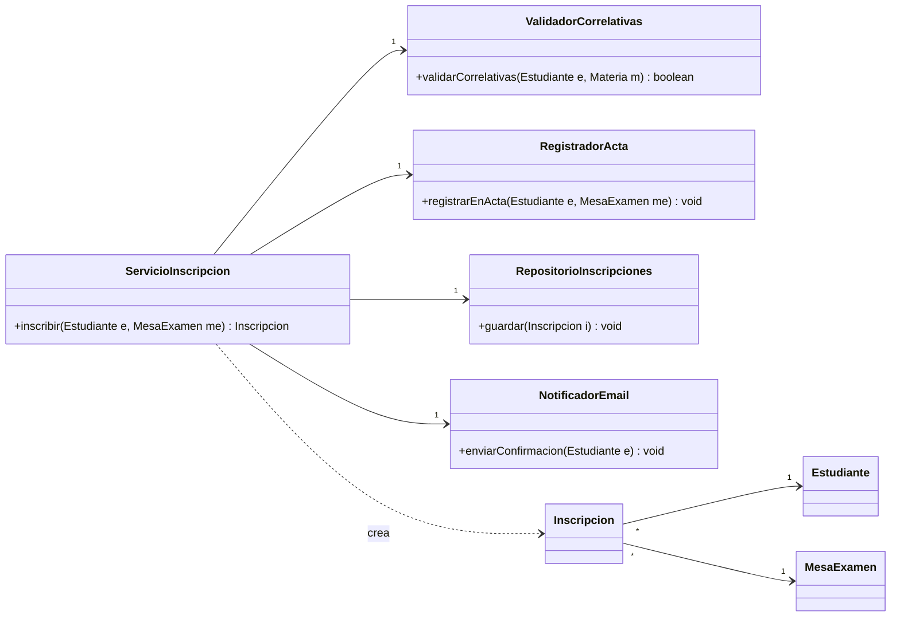
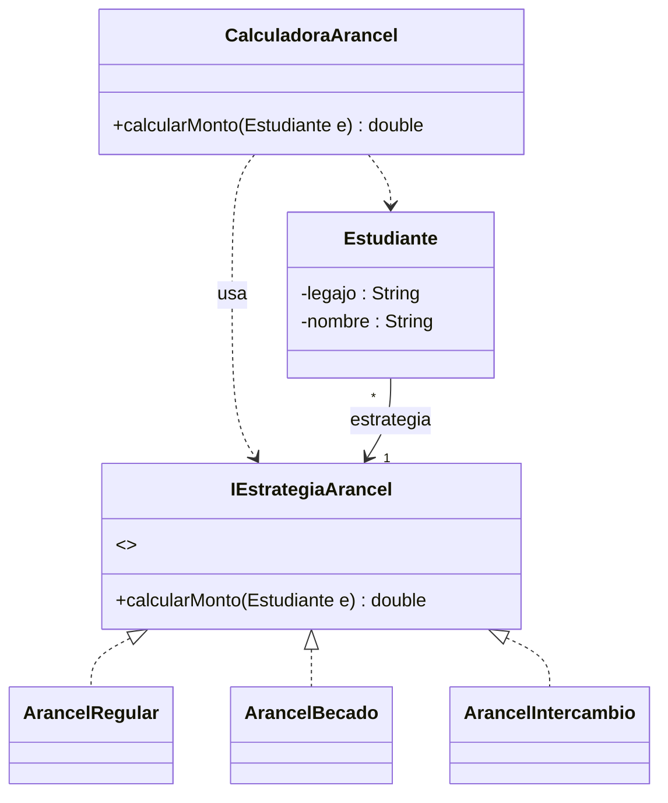
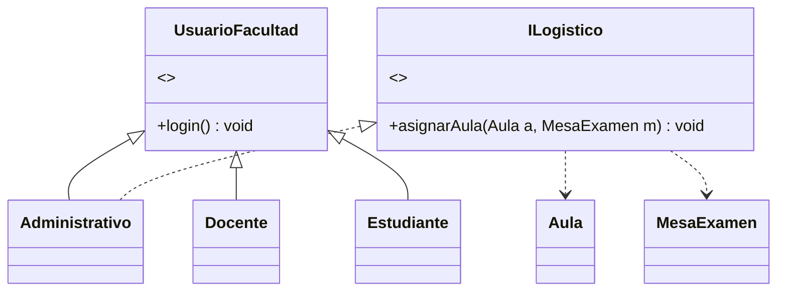
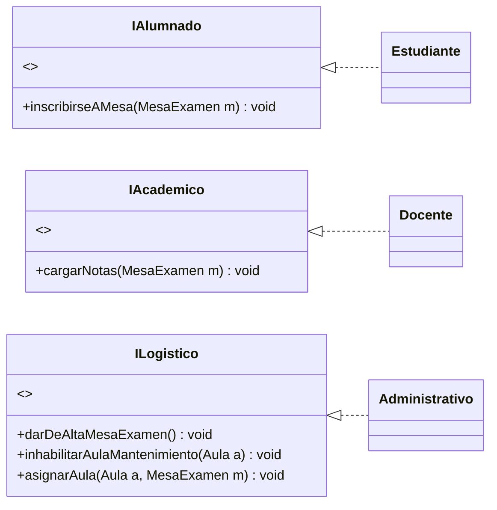
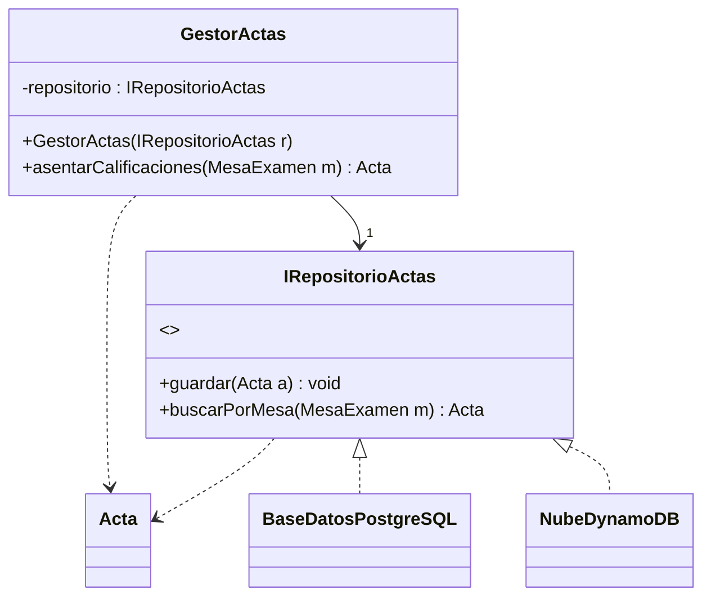

# Trabajo Práctico: Refactorización SOLID

Programación Orientada a Objetos II · Sistema de Gestión Académica

## Ejercicio 1 · SRP

### Por qué rompe SRP

`GestorInscripciones` tiene **4 razones para cambiar**, cada una con un “cliente” distinto: (1) las reglas de correlatividades (área académica), (2) el formato/registro del acta (secretaría), (3) la tecnología de persistencia (infraestructura) y (4) el canal o texto de notificación (comunicación). Tiene baja cohesión: mezcla reglas de negocio, persistencia y notificaciones.

### Solución

- **ValidadorCorrelativas**: decide si el estudiante cumple las correlativas de la materia.
- **RegistradorActa**: asienta la inscripción en el acta de la mesa.
- **RepositorioInscripciones**: persiste la `Inscripcion` (fabricación pura).
- **NotificadorEmail**: envía la confirmación.
- **ServicioInscripcion**: controlador/orquestador. No tiene reglas propias, solo coordina el orden de los pasos.

## Ejercicio 2 · OCP

### Por qué rompe OCP

El `switch` sobre `tipoEstudiante` obliga a **modificar** `CalculadoraArancel` (código ya probado) cada vez que aparece un tipo nuevo. Está cerrada a la extensión y abierta a la modificación, al revés de lo que pide el principio.

### Solución

- Se elimina `tipoEstudiante` y el `switch`.
- **IEstrategiaArancel** define `calcularMonto(Estudiante)` (Strategy / polimorfismo GRASP).
- **ArancelRegular**, **ArancelBecado** y **ArancelIntercambio** implementan cada regla.
- Cada `Estudiante` tiene asociada su estrategia; `CalculadoraArancel` solo conoce la interfaz. Un tipo nuevo = una clase nueva, sin tocar la calculadora.

## Ejercicio 3 · LSP

### Por qué rompe LSP

Un cliente que recibe un `UsuarioFacultad` espera poder llamar `asignarAula()`. Con `Docente` o `Estudiante` el método lanza `ExcepcionOperacionNoPermitida`: el subtipo **refuerza las precondiciones** y rompe el contrato de la superclase, por lo que no es sustituible. No hay un “es-un” de comportamiento.

### Solución

La clase base queda solo con lo común (`login()`). La capacidad logística se extrae a la interfaz **ILogistico**, implementada solo por `Administrativo`. Quien necesite asignar aulas pide un `ILogistico`, no un usuario cualquiera.

## Ejercicio 4 · ISP

### Por qué rompe ISP

`ISistemaUniversitario` obliga a `Docente` a depender de `inscribirseAMesa()` e `inhabilitarAulaMantenimiento()`, que no usa y deja vacíos. Es una interfaz con baja cohesión.

### Solución

- **IAlumnado**: `inscribirseAMesa()` → `Estudiante`.
- **IAcademico**: `cargarNotas()` → `Docente`.
- **ILogistico**: `darDeAltaMesaExamen()`, `inhabilitarAulaMantenimiento()` y `asignarAula()` (del ejercicio 3) → `Administrativo`.

Supuesto: la gestión de mesas se considera tarea logística/administrativa. Si su cátedra la asigna al docente, muévanla a `IAcademico`.

## Ejercicio 5 · DIP

### Por qué rompe DIP

`GestorActas` (alto nivel, reglas de gestión de actas) depende directamente de `BaseDatosPostgreSQL` (bajo nivel, detalle de infraestructura). Migrar a la nube obliga a reescribir la lógica de negocio.

### Solución

Se introduce **IRepositorioActas**. `GestorActas` recibe la implementación por constructor (inyección de dependencias) y solo conoce la interfaz. Las bases concretas también dependen de la abstracción: la flecha de dependencia de bajo nivel se invierte hacia la interfaz.

## Resumen

- **SRP** → alta cohesión (Controlador, Fabricación pura)
- **OCP** → Polimorfismo y Variaciones protegidas (Strategy)
- **LSP** → subtipos sustituibles: la capacidad logística sale de la jerarquía
- **ISP** → interfaces por rol, menor acoplamiento
- **DIP** → Indirección: el alto nivel depende de la abstracción